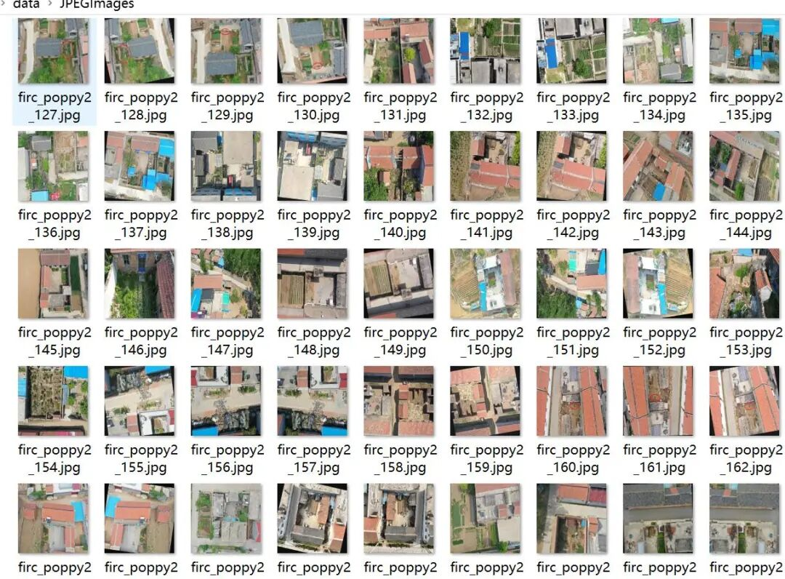
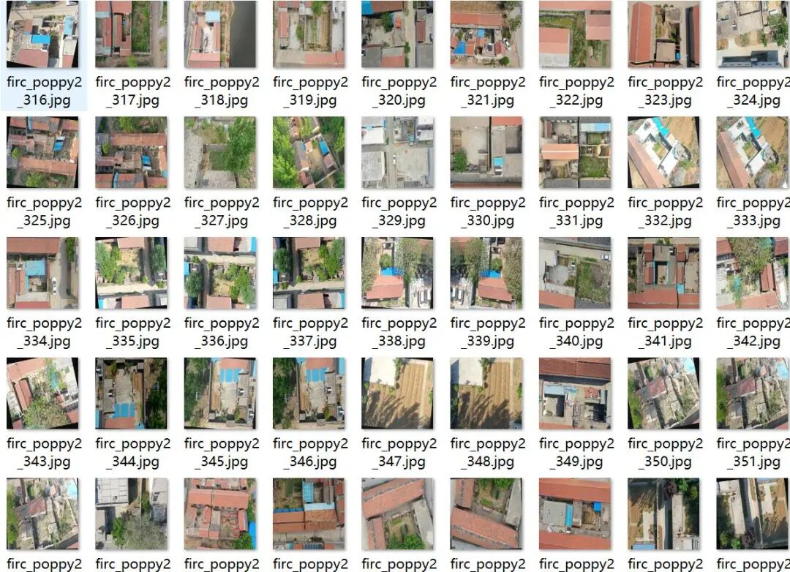
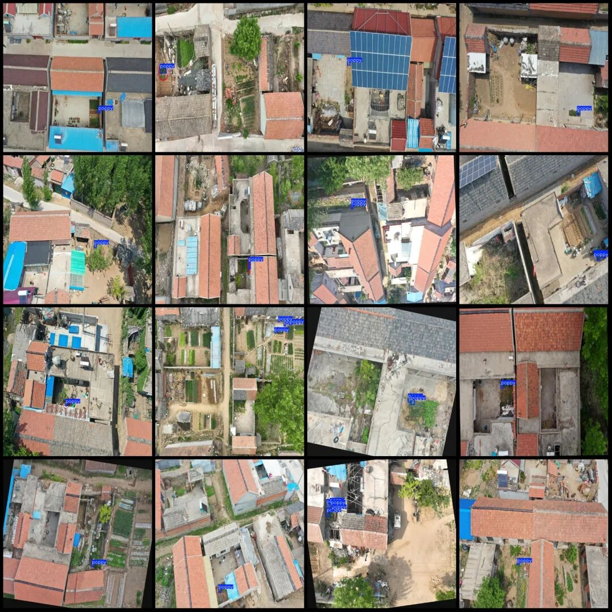

# Drone-View Phyllodyne Detection Dataset VOC+YOLO format: 482 images, 1 category

Some of the images in the dataset are enhanced with rotation. Note that all labeled areas in the dataset have red circles drawn around them, which theoretically do not affect recognition accuracy since the features inside the boxes seldom include the red circles, which are treated as background during training.

Some of the images in the dataset are enhanced with rotation. Note that all labeled areas in the dataset have red circles drawn around them, which theoretically do not affect recognition accuracy since the features inside the boxes seldom include the red circles, which are treated as background during training.

Dataset format: Pascal VOC format + YOLO format (txt file without split path, only containing jpg images and corresponding VOC format xml files and yolo format txt files)

Number of images (number of jpg files): 482

Number of annotations (number of xml files): 482

Number of annotations (number of txt files): 482

Label category count: 1

Label category name (Note that the order of yolo format categories does not correspond to this, but is based on the labels folder's classes.txt): ["poppy"]

Number of boxes labeled in each category:

Poppy Frames = 934

Total frame count: 934

Image resolution: 640x640

Using labelImg:

Annotation rules: Draw a rectangle around the category.

Important Notice: No

Special : This dataset does not guarantee the accuracy of the trained models or weight files.

Image Preview:

Annotation example:

## Payment

Here is a pay link on Stripe ( https://buy.stripe.com/3cs8yP7sY87d0vu9AB ). Please contact me lonlonago@foxmail.com after funding $89, and I will send you a complete data files , thank you!

